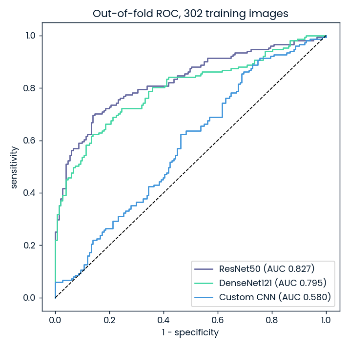
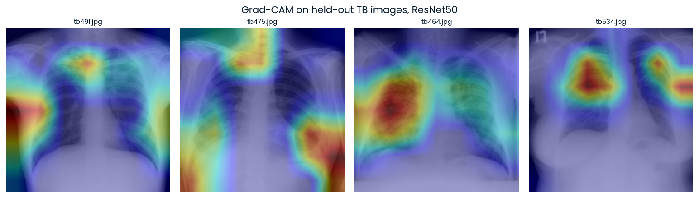

# Detecting Tuberculosis in Chest X-rays

Three models — a CNN trained from scratch, ResNet50 and DenseNet121 — trained to tell
tuberculosis from normal chest radiographs on a small dataset, with 5-fold cross-validation,
Grad-CAM attention checks and bootstrap confidence intervals.

**The main result here isn't a model. It's a confounder found in the project's own data.**

---

## The short version

An earlier version of this work reported test-set AUCs of 0.97–0.98 and looked finished.
Those numbers were wrong, and finding out why took a while.

In the held-out test folder, the average brightness of an image separates healthy from TB
almost perfectly — AUC 0.996. In the training folder the same statistic is at chance, 0.566.
The healthy test images are about 50 grey levels brighter than healthy training images and
come from a different source. Any model that picks up even a weak brightness signal during
training scores near-perfectly on that test set without having learned anything about
tuberculosis.

So every test-set number is withdrawn. What's left is cross-validation on the clean training
set, and those numbers are far more modest.

## Results

Out-of-fold predictions on 302 training images (151 healthy / 151 TB), 95% bootstrap
intervals.

| model | ROC-AUC | PR-AUC | sensitivity | specificity |
|---|---|---|---|---|
| **ResNet50** | **0.83 [0.78–0.87]** | 0.86 [0.81–0.89] | 0.89 [0.84–0.94] | 0.46 [0.38–0.54] |
| DenseNet121 | 0.80 [0.74–0.85] | 0.83 [0.79–0.87] | 0.87 [0.81–0.93] | 0.28 [0.21–0.36] |
| Custom CNN | 0.58 [0.51–0.64] | 0.58 [0.52–0.64] | 0.90 [0.85–0.94] | 0.25 [0.18–0.31] |

Every image is predicted by the one fold model that never saw it in training. The cutoff
behind sensitivity and specificity is fitted on the other four folds, so nothing is scored
with a threshold picked on the same data.



**Does transfer learning help here?** Yes, clearly. Paired bootstrap on the same images:

| comparison | AUC difference | real? |
|---|---|---|
| ResNet50 − DenseNet121 | +0.032 [−0.006, +0.073] | no |
| ResNet50 − Custom CNN | +0.249 [+0.167, +0.325] | yes |
| DenseNet121 − Custom CNN | +0.216 [+0.139, +0.288] | yes |

The two pretrained backbones can't be told apart. Both beat training from scratch by a wide
margin. With 302 images a network trained from scratch never gets off the ground — which
backbone you pick matters far less than whether you use one.

**Where to set the cutoff.** At its best balance (Youden's J) ResNet50 catches 70% of TB
cases and correctly clears 85% of healthy ones. Pushing sensitivity to 90% drops specificity
to 46% — at this level of performance you can't have both. One detail worth noting: both
pretrained models identify about 20% of TB cases with no false positives at all, which
suggests a narrower job than screening.

## How the confounder was found

The thing that didn't add up: each fold model scored 0.55–0.68 on its own validation fold
but 0.97–0.997 on the test set — and one fold scored 0.003, having learned the task
backwards. Held-out training data should not be harder than an external test set.

Four checks, in order:

1. **Duplicate images.** Hash-based and then by content similarity. None — the test images
   are not copies of training images, and nearest-neighbour similarity between the folders
   is actually *lower* than within the training set.

2. **Trivial image statistics.** Mean brightness, contrast, percentiles and file size, each
   scored as a one-feature classifier. The training folder sits at 0.50–0.63. The test
   folder: mean brightness 0.996, p95 0.989, file size 0.934, contrast 0.889.

   | | healthy | TB |
   |---|---|---|
   | train | 147.2 ± 13.3 | 143.9 ± 8.4 |
   | test | **196.8 ± 12.8** | 144.2 ± 9.7 |

   The TB images agree across folders. It's the healthy test images that are off.

3. **Can normalization fix it?** No. Per-image z-scoring wipes out brightness and contrast
   by construction, and p25 still separates the test classes at 0.999 — the whole *shape*
   of the intensity distribution differs. Histogram equalization closes most of the gap but
   still leaves 0.80–0.87 against a 0.55 baseline, which fits bright images with blown-out
   white areas that can't be reconstructed.

4. **Adversarial validation** — can a classifier tell which folder an image came from?
   Healthy: 0.977. TB: 0.626, against a null of 0.503 from random splits of the training TB
   images (permutation p = 0.04, 100 runs). So the healthy images are a different population,
   and even the TB images shifted slightly — enough to keep the folders apart.

## Does the model look at the lungs?

Grad-CAM on held-out training images, each explained by the fold model that didn't train on
it:

- **border heat 0.488** — share of attention in the outer 15% of the frame, against 0.51 for
  a flat map. Attention is pulled inward, but only just.
- **heat vs brightness −0.346** — on a radiograph bone is bright and air-filled lung is dark,
  so a negative number means attention sits in the lung fields.



Both are weaker than the same numbers measured on the test set earlier (0.379 and −0.447).
That's the point: those maps looked sharper because the model had a shortcut to hold onto.
This is what a 0.83 AUC model actually looks like — pointed the right way, not sharply enough
to hand a radiologist.

## Method

- **Data.** 302 chest radiographs, 151 healthy / 151 TB, in class subfolders. A separate
  100-image folder was supplied as a test set and is excluded for the reasons above.
- **Validation.** 5-fold stratified cross-validation, one split object shared by all three
  models so they see identical folds.
- **Custom CNN.** Four conv blocks (32→64→128→256) with batch norm, global average pooling,
  sigmoid. Grayscale input, rescaled to [0, 1]. ~0.45M parameters.
- **ResNet50 / DenseNet121.** ImageNet weights, trained in two stages — head first at
  LR 1e-3, then the last block unfrozen at LR 1e-5 with all BatchNorm layers held frozen,
  since recomputing BN statistics on batches of 16 would corrupt the pretrained weights.
  RGB input with each network's own `preprocess_input`.
- **Augmentation.** Rotations, small shifts, zoom and brightness jitter on the training split
  only. Horizontal flipping is off for the CNN — mirroring a chest X-ray puts the heart on
  the wrong side.
- **Metrics.** ROC-AUC and PR-AUC are primary and need no cutoff. Threshold-based metrics use
  a nested cutoff, fitted per fold on the other four.

## Limitations

- **302 images is very little.** The confidence intervals are wide and they're honest about it.
- **No patient IDs.** If one patient contributed more than one radiograph, images from the
  same person could land in different folds. Nothing in the data lets this be checked.
- **No external validation.** The one external set available turned out to be confounded.
  How these models behave on radiographs from a different hospital or machine is unknown,
  and that is the question that matters most for a clinical tool.
- **This is not a diagnostic tool.** At 0.83 AUC it misses roughly 30% of cases at a usable
  specificity.

## What's in here

```
notebooks/   analysis notebook, run top to bottom
src/         the same pipeline as plain .py with cell markers
figures/     ROC curves, Grad-CAM panels, confounder diagnostics
results/     metrics, model comparison and operating points as CSV
```

Trained model weights are not in the repository (too large for git). The notebook retrains
them in about 1.2 hours per architecture on CPU, less on a GPU.

## Reproducing

```bash
pip install -r requirements.txt
```

Point `TRAIN_DIR` at a folder with class subfolders and run the notebook top to bottom. The
cross-validation cells are the expensive part; everything downstream runs off saved
out-of-fold predictions in seconds.
